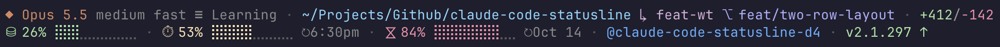

# claude-statusline

A compact, two-row statusline for [Claude Code](https://claude.com/claude-code) written in bash. Shows what's running, where you are, how much context is left, and whether a Claude Code update is waiting.

## Screenshot

.

## Features

- **Messaging name** — the session's name that other Claude Code sessions use to message it (`@loretta-76`, `@claude-code-statusline-d4`) sits near the end of the bottom row, just before any pending update — reference info you look up when you need it. Claude Code doesn't put it in the statusline payload, so it's read from the session's own record in `~/.claude/sessions/<pid>.json` (matched on `sessionId`; `CLAUDE_CONFIG_DIR` relocates it). The `@` marks it as an address. Older versions that don't write a name fall back to the first 8 characters of the session UUID, shown as `#abc12345` — `#` for an id you can't message.
- **Update-ready indicator** — the version is hidden while you're up to date. When a newer Claude Code is installed than the one running, a green `v2.1.297 ↑` appears at the end of the bottom row: the version a restart will bring. Detected by reading the versioned symlink target, no subprocess spawn.
- **Graceful degradation** — every element is conditional. If a field is missing from the input JSON (older Claude Code versions, pending data before the first API response, etc.), the section is silently skipped rather than showing `null` or `0`.
- **Worktree-aware location** — inside a linked git worktree, an `↳ wt-name` label sits between the directory and the branch (`~/repo ↳ wt-name ⎇ feat`); the main checkout shows just the directory and branch. The label is skipped when the folder already ends in that name (`~/…/worktree02 ⎇ feat`, not `~/…/worktree02 ↳ worktree02 ⎇ feat`). Detection is from the worktree's git-dir, so it works however the worktree was created, but the label is the checkout directory's own name — git's internal worktree id is a sanitized, de-duplicated basename that can degrade to `0` or `-`.
- **Color-coded progress bars** — 10-cell braille blocks (`⣿⣀`) at 10% increments for context usage and both rate windows, with the percentage to the left: green under 50%, yellow 50–79%, red 80% and up. Only the used cells take the color; the empty track is dark grey, so a low reading is a short stub rather than a full-width colored line. The gap-free fill mirrors Claude Code's own `/usage` bars.
- **Both rate windows** — the 5-hour session window (`⏱`) and the 7-day weekly window (`⧖`) each get their own bar and reset time. Either window is rendered only when Claude Code sends it (they can be independently absent), so the weekly segment simply doesn't appear until there's data. Inspired by [claude-pace](https://github.com/Astro-Han/claude-pace).
- **Absolute reset times** — each rate window shows *when* it resets, like the `/usage` view: `↻8:10pm` if it resets later today, `↻Jun 1` if it resets on another day. No pacing or projection math — just how much you've used and when it comes back.
- **Rate limits synced across sessions** — Claude Code only refreshes `rate_limits` after an API call, so a fresh session (or a fresh login) shows nothing and an idle session keeps replaying whatever it last saw — a window that already reset, a pegged 100%, the numbers from before a limit boost. Nothing in the payload says *when* those numbers were fetched, so the script measures it: a process only changes its rate limits when a new response arrives, so a value that differs from what that session reported on its previous tick was fetched now, and an unchanged value is a replay that keeps its original fetch time. Every session records what it last reported (per session id) and publishes its observation to a tiny shared file; every render shows whichever observation — this payload's or the shared file's — was fetched later. Freshness is never guessed from the numbers themselves (an earlier "usage only grows" rule pinned a spent window at 100% after Anthropic boosted the limit, while `/usage` showed 1%). A new session inherits the last-known usage and reset time immediately, a stale session re-syncs the moment any other session gets fresh data, and once a window's `resets_at` passes it rolls over to `0%` instead of freezing at its final stale value.
- **Per-account rate limits** — rate limits belong to a Claude account, and `/login` switches every running session at once, so the shared snapshot is keyed by the account in `~/.claude.json`. Log into another account and the bars start clean (`⏱ --`) instead of showing the account you just left; log back in and that account's own last-known usage is restored immediately rather than waiting for the next API response. Claude Code keeps rate limits in memory per process, so sessions that were already running keep replaying the previous account's numbers until their next API call — the per-session record remembers which account those numbers were fetched under, so an unchanged replay after a switch is attributed to the old account and ignored: it never renders and never poisons the new account's snapshot. The session's first *changed* response after the switch is trusted as the new account's. (A payload from a session with no record yet that matches another account's snapshot exactly — same used% *and* the same reset second — is caught the same way.)
- **Idle-proof usage** — header-fed numbers can only change when some session makes an API call, so if every session is idle when Anthropic boosts or resets a limit nothing would move. The statusline therefore also asks the same endpoint the `/usage` view reads (`GET https://api.anthropic.com/api/oauth/usage`, using the OAuth token Claude Code already holds) — but only when the newest observation on hand is older than 3 minutes, so an active session never triggers it (headers refresh every turn) and an idle one costs a single call per interval. The call runs detached in the background, never blocks a tick, is shared across sessions with a lock, backs off for 10 minutes after any failure, and its result is just one more timestamped observation that wins only when it is genuinely the newest. Disable with `CLAUDE_SL_USAGE_TTL=0`.
- **Clamped percentages** — context and rate usage can come off the wire fractionally over 100 when fully spent (rendering as `101%`); everything is clamped to 0–100.
- **Compact model name** — strips the `Claude ` prefix and collapses any `(1M context)` / `(200K context)` annotation to a bare size token, so `Claude Opus 4.7 (1M context)` shows as `Opus 4.7 1M` and `Claude Sonnet 4.6` as `Sonnet 4.6`.
- **Single-pass jq extraction** — one `jq` invocation pulls every field out of the payload, avoiding the ~20-process fan-out of naive scripts. (A second, much smaller `jq` reads the logged-in account from `~/.claude.json`, at most once every 5 seconds.)
- **Cached git work** — one cache covers the branch, the worktree label, and the lines-changed diff, so `git` doesn't run on every statusline tick. It refreshes on a 5-second TTL **or the moment the checkout moves**: the cache remembers the content of `.git/HEAD` and the index's mtime, so a `git checkout`, `add`, `commit`, or `reset` shows on the very next tick instead of up to 5 s later. A cache hit costs zero subprocesses (no `stat`, no `git`); a refresh is five `git` calls regardless of how many mainline or parent refs exist.
- **Two rows, nothing cut off** — the top row is *what and where* (model with effort, fast mode and output style, directory, worktree, branch, lines changed); the bottom row is the gauges followed by reference info (context, both rate windows, messaging name, pending update). Opening the bottom row with the context gauge keeps the bars in the same columns whatever the model or path. A single row ran past the edge of the terminal and was cut off with `…` once the project path got long. The script can't adapt to the width because it never gets told the terminal width.
- **Fast mode** — shows as `fast` after the effort level (`◆ Opus 5.5 medium fast`). An open PR is left to Claude Code, whose footer already shows it as a clickable link with its review state.
- **Spacer row** — a blank row after the statusline separates it from Claude Code's own footer (permission mode, shells, agents, workflow progress). Set `CLAUDE_SL_SPACER=0` to drop it.
- **Few processes per tick** — on a typical tick the only process started is the one `jq` that parses the payload (~60 ms per render on an M-series Mac, about 20 ms of it `jq`). Stdin, the clock, reset-time formatting, cache ages and the update check all use bash builtins (`read`, `$EPOCHSECONDS`, `printf %(…)T`, `-ef`), temp files are named by PID instead of `mktemp`, and the shared rate snapshot is only rewritten when it changes. Stock macOS bash 3.2 falls back to `date` where a builtin is missing.
- **Self-cleaning caches** — once a day a detached `find` removes this script's cache files untouched for 7 days (finished sessions' records, git caches for directories you no longer visit, temp files from an interrupted tick). Each one is rebuilt on demand.
- **Terminal-safe output** — each row starts and ends with an ANSI reset so colors never leak into surrounding content, and there's no trailing newline (Claude Code counts newlines to determine row count).

## Statusline Elements

The top row holds the model through lines changed; the bottom row holds context usage through the pending update. Within a row, from left to right, each element is separated by a dim `·`. When the top row would be empty (no model, effort, or directory), only the bottom row is printed.

| Element | Example | Color | Notes |
| --- | --- | --- | --- |
| **Model** | `◆ Opus 4.7 1M` | orange | Starts the top row. `Claude ` prefix stripped; `(1M context)` / `(200K context)` collapsed to a bare size token. |
| **Effort level** | `high` | grey | Right after the model name (`◆ Opus 4.7 1M high`), only when an effort level is set. |
| **Output style** | `☰Explanatory` | grey | After the effort level (`◆ Opus 5.5 medium ☰Learning`). Hidden when the style is `default`. |
| **Fast mode** | `fast` | grey | After the effort level, only while fast mode is on. |
| **Directory** | `~/Documents/projects` | sky blue | Home directory is abbreviated to `~`. A `<repo>/.claude/worktrees/<name>` tail collapses back to the repo root, so a worktree shows its repo path plus the `↳` label rather than a long nested path. |
| **Worktree** | `↳ wt-name` | thistle pink | Shown between the directory and the branch (`~/repo ↳ wt-name ⎇ feat`) only when inside a *linked* git worktree, and only when the directory doesn't already end in that name. The name is the worktree's **checkout directory** name, not git's internal worktree id — that id is a sanitized, de-duplicated basename that can degrade to `0` or `-` on collision. |
| **Git branch** | `⎇ main` | lavender | Only when inside a git repo. Falls back to short commit SHA if HEAD is detached. |
| **Lines changed** | `+35/-31` | green / red | Real `git diff` of the current branch/worktree against its fork point — every tracked line **added/removed since the branch diverged from the mainline**, counting committed, staged, and unstaged edits together. The fork point is the **newest** merge-base against any of the branch's candidate parents: the mainline refs (`main`, `master`, `origin/HEAD`, `origin/main`, `origin/master`) **and, for stacked branches, the recorded parent** — read from whichever tool wrote it: `gh` (`branch.<b>.gh-merge-base`), git-town (`git-town-branch.<b>.parent`), Graphite (`refs/branch-metadata/<b>`), or plain git's local upstream (`git branch --set-upstream-to=parent`) — falling back to git's own reflog (`branch: Created from <parent>`, written by `git checkout -b child parent` or `git worktree add -b child <path> parent`) when no tool recorded one. When a stacked branch has also merged `main` in, it has two fork points (parent tip and main tip), and the count is taken against their merge. So a feature branch shows all its work, a child branch shows only its own lines rather than its parent's, merging a newer `origin/main` into a branch does not count the upstream lines even when local `main` is stale, and `main` itself shows just uncommitted changes. Untracked files are excluded, and the whole segment is hidden when the tree is clean. Computed inside the git cache, so no extra cost per tick. |
| **Context usage** | `⛁ 23% ⣿⣿⣀⣀⣀⣀⣀⣀⣀⣀` | green / yellow / red | Percent of the context window consumed by the current conversation, with a 10-cell bar. Shows `⛁ --` before the first API response. |
| **5-hour window** | `⏱ 74% ⣿⣿⣿⣿⣿⣿⣿⣀⣀⣀ ↻8:10pm` | green / yellow / red | Percent of the 5-hour rate limit used (clamped to 100). Claude Pro/Max only. Before the first API response it inherits the last-known snapshot from any other session **on the same account**; shows `⏱ --` only when that account has no published snapshot (including right after switching accounts). Appends the reset time when `resets_at` is present — see below. |
| **7-day window** | `⧖ 36% ⣿⣿⣿⣿⣀⣀⣀⣀⣀⣀ ↻Jun 1` | green / yellow / red | Percent of the 7-day (weekly) rate limit used, read from `rate_limits.seven_day` (clamped to 100). Same bar, reset time, and cross-session sync as the 5-hour window, distinguished by the `⧖` glyph. Silently skipped when the weekly window is absent from both the payload and the shared snapshot. |
| **Reset time** | `↻8:10pm` / `↻Jun 1` | grey | When the rate window resets, read from `resets_at`. Shows the clock time if it resets later today, otherwise the month + day. Hidden if the reset is further out than the window itself. If the reset has already *passed*, the window rolled over — the segment shows `0%` with no `↻` (the new window's anchor is unknown until the next API response). |
| **Messaging name** | `@loretta-76` | blue | The name other sessions message this one by, from `~/.claude/sessions/<pid>.json`. Falls back to `#abc12345` (first 8 chars of the session UUID) when no name is recorded. |
| **Pending update** | `v2.1.297 ↑` | green | Only when the installed Claude Code differs from the running one; shows the installed version, which a restart switches to. Hidden otherwise. |

### Progress bar thresholds

Green, yellow and red are used only for these thresholds (and git's `+added`/`-removed`), so a gauge's warning color never looks like a folder or model name.

All progress bars use the same 10-cell braille-block display and color thresholds:

- **Green** — 0–49% (healthy)
- **Yellow** — 50–79% (watch)
- **Red** — 80–100% (act soon)

## Setup

### Prerequisites

- Bash 4.2+ recommended (macOS ships with 3.2 — `brew install bash` for the builtin fast paths; the script works on 3.2 too, starting a few extra `date` processes). Runs on macOS and Linux: platform-specific commands (`stat`, `date -r`, the Keychain) are either avoided or have a fallback.
- `jq` installed and on your `PATH`
- [Claude Code](https://claude.com/claude-code) installed
- A font with braille block glyphs (`⣿` `⣀`) — included in most modern monospaced fonts; confirmed working in Ghostty, iTerm2, WezTerm, Alacritty

### Install

```sh
# Clone somewhere permanent
git clone https://github.com/tedserbinski/claude-code-statusline.git ~/claude-statusline

# Point Claude Code at the script
```

Add (or edit) the `statusLine` block in `~/.claude/settings.json`:

```json
{
  "statusLine": {
    "type": "command",
    "command": "bash ~/claude-statusline/statusline-command.sh"
  }
}
```

Restart Claude Code (or open a new session) and the statusline should appear at the bottom of the terminal.

### Testing

A test suite covering 66 checks (full payloads, boundary values, missing fields, model-name shortening, braille bars, absolute reset times, percentage clamping, cross-session rate sync, boosted/reset limits, the usage endpoint (fixture-fed, non-blocking, backoff), per-account rate isolation, the weekly window, worktree labelling, lines-since-fork with a stale local `main`, instant refresh on branch switch, stacked branches under every parent convention (including the creation reflog, in a linked worktree, and after merging `main`), rapid redraws, performance) is included:

```sh
bash ~/claude-statusline/test-statusline.sh
```

Expected output ends with `All 76 tests passed ✓`. If any test fails, the output line count or stderr leakage is almost always the cause — see the "Troubleshooting" section below.

## Customization

All the meaningful knobs are in the top of `statusline-command.sh`:

- **Colors** — the `C_GREEN`, `C_YELLOW`, `C_LAVENDER`, etc. variables near the top of the script use standard ANSI 16-color codes and 256-color escapes. Swap in your own palette.
- **Bar width** — `build_bar`'s default total is 10 cells, one per 10% (search for `total=`). Lower it for more compact bars, raise it for finer granularity.
- **Bar glyphs** — filled/empty are `⣿` and `⣀` inside `build_bar`. Swap them for a different look (e.g. `█`/`░` for solid blocks, or `⡇`/`⡀` for a thinner braille line).
- **Usage thresholds** — the 50% / 80% color break points live in `build_bar`, which sets the bar color and the matching percentage color together. Change them if you want different warning levels.
- **Git cache TTL** — defaults to 5 seconds (search for `now_ts - c_at >= 5`). Raise it if your repo is huge and git calls are slow; a branch switch or commit still refreshes immediately because the cache is also keyed on `.git/HEAD` and the index mtime.
- **Rate snapshot location** — every cache lives in `$TMPDIR` (per-user on macOS), or `/tmp/claude-sl-<uid>` when `$TMPDIR` is unset (Linux, where `/tmp` is shared between users). The shared cross-session rate file is `claude-sl-rate-<account-uuid>` (used%, reset time, and fetch time for each window), next to a `claude-sl-account` file caching which account is logged in (5-second TTL, so a `/login` is picked up almost immediately) and one `claude-sl-seen-<session-id>` record per session holding what that session last reported and when it was fetched. Set `CLAUDE_SL_CACHE_DIR` to move all of them (the test suite uses this for isolation). Delete a snapshot to reset the sync state for that account. Logged out — or authenticating with an API key, which has no subscription rate limits — falls back to the unsuffixed `claude-sl-rate`.
- **Account identity** — read from `oauthAccount` in `$CLAUDE_CONFIG_DIR/.claude.json` (defaults to `~/.claude.json`). Set `CLAUDE_SL_ACCOUNT` to pin it yourself and skip that lookup entirely.
- **Usage endpoint** — `CLAUDE_SL_USAGE_TTL` is the minimum age (seconds) of the newest observation before the statusline asks `api.anthropic.com/api/oauth/usage`; default `180`, and `0` disables the endpoint entirely (the statusline then relies on headers alone). Polling faster than that is known to get the endpoint rate-limited. Results are cached at `$TMPDIR/claude-sl-usage-<account-uuid>` (a `.err` sibling holds the 10-minute backoff after a failure). The OAuth token is read from the macOS Keychain item `Claude Code-credentials` (or `$CLAUDE_CONFIG_DIR/.credentials.json`, default `~/.claude/.credentials.json`) inside the background job only, is sent only to that endpoint, and is never written anywhere. `CLAUDE_SL_USAGE_TOKEN` and `CLAUDE_SL_USAGE_URL` override both (the test suite uses them to fetch from a local fixture). Tokens from `claude setup-token` lack the `user:profile` scope the endpoint needs — sign in with the browser flow for it to work.
- **Reset time format** — `build_rate_segment` formats the reset with `date` (`%l:%M%p` for today, `%b %e` otherwise). Adjust those format strings to taste (e.g. 24-hour clock).

## How the Update Indicator Works

The script detects an installed-but-not-running Claude Code update by comparing two version strings:

1. **Running version** — read from the `version` field of the JSON payload that Claude Code pipes to the script's stdin.
2. **Installed version** — read from the target of the `claude` binary symlink. Claude Code's installer creates `~/.local/bin/claude` as a symlink pointing at `~/.local/share/claude/versions/<version>/`, so the version number is literally the last path component of the symlink target.

Reading the symlink is a single `readlinkat()` syscall (<1ms), so it runs on every tick with no cache — keeping it cache-free means the indicator appears as soon as Claude Code auto-updates mid-session, and disappears once you restart into the new version.

If the running and installed versions differ, `update_available` is set and the statusline ends with a green `v<installed> ↑` — the version you'll be on after restarting Claude Code. While they match, no version is shown at all.

Note that the symlink approach only works for Claude Code installed via the native installer. If you installed through a package manager (Homebrew, npm global), `claude` may not be a symlink and the update indicator will silently do nothing.

## Other Terminals and Agent Hosts

- **Any terminal emulator** (Ghostty, iTerm2, WezTerm, Alacritty, Kitty, Terminal.app, tmux): the output is plain text with 256-color ANSI codes, so it renders anywhere Claude Code does. You need a font with the braille (`⣿⣀`) and symbol (`⛁ ⏱ ⧖ ⎇ ◆`) glyphs.
- **[herdr](https://herdr.dev)** (a multiplexer for running many coding agents side by side): every pane is a real terminal running Claude Code, so this statusline renders as usual. herdr's sidebar is separate. It accepts short plain-text values via `herdr pane report-metadata` (80 characters max, no ANSI), so you'd feed it a summary from a hook, not this script's output.
- **[pi](https://pi.dev)** (a different coding agent): pi has no `statusLine` command setting. Its footer is driven by TypeScript extensions (`ctx.ui.setStatus` / `ctx.ui.setFooter`). You could port the layout by writing an extension that builds a Claude-Code-shaped payload and runs this script. The rate limits, messaging name and update check rely on Claude Code's own files and OAuth token, though, so they'd stay empty there.

## Troubleshooting

**Statusline appears twice in the terminal or leaks into scrollback.** This is a known Claude Code rendering bug ([issue #17519](https://github.com/anthropics/claude-code/issues/17519)) affecting iTerm2 and Ghostty. It's caused by the React Ink renderer not fully clearing the old statusline position during content reflow. Not fixable from the script side.

**Tests fail with multi-line output.** If the test suite reports `LINE COUNT: 4 rows (expected ≤ 3)`, something is emitting to stderr. Common cause: a jq type error on an unexpected field shape. Run the script manually with a sample payload and `2>&1 | cat -v` to see the error.

**Progress bars show `⛁ --` and `⏱ --` instead of percentages.** This is normal before the first API response in a brand-new session — the `context_window.used_percentage` and `rate_limits.five_hour.used_percentage` fields aren't populated yet. Context always waits for the first message (it's per-conversation), but the rate bars inherit the last-known snapshot from any other recent session on the same account, and failing that the background fetch from the usage endpoint fills them in within a few seconds of the first tick. `⏱ --` persisting means that fetch isn't working: the account has no published snapshot (right after a reboot, since the snapshot lives in `$TMPDIR`, or right after switching accounts) **and** the endpoint can't be reached — usually a token from `claude setup-token` (missing the `user:profile` scope; sign in with the browser flow), `CLAUDE_SL_USAGE_TTL=0`, or a `$TMPDIR/claude-sl-usage-<account>.err` backoff marker from a recent failure (delete it to retry immediately). It always fills in as soon as the account gets its first API response.

**Version doesn't show.** The `version` field in the JSON payload was added in a recent Claude Code release. Older versions don't send it, and the script silently skips the section.

**Update indicator never appears.** Check that `~/.local/bin/claude` is a symlink: `readlink ~/.local/bin/claude`. If it returns an absolute path containing the version, the indicator should work. If it returns nothing or the file isn't a symlink, you likely installed Claude Code through a package manager and the detection won't work.

## Design Notes

- **Single jq call** — extracting all 13 payload fields in one `jq -r '@sh ...'` call and using `eval` to assign them is roughly 10x faster than the naive `var=$(echo "$input" | jq -r '.foo')` pattern repeated per field.
- **Variable-based helpers instead of subshell capture** — `build_bar` writes to a global `_bar_result` variable instead of echoing, so callers don't incur a subshell per call. This matters because subshell stdout capture can interleave ANSI escape sequences across buffer boundaries in rare cases.
- **Leading ANSI reset** — every output line starts with `\033[0m` to override Claude Code's ambient dim styling. Pattern borrowed from [ccstatusline](https://github.com/sirmalloc/ccstatusline).
- **No trailing newline** — Claude Code counts `\n` characters to determine how many rows the statusline occupies. The newlines between the rows are intended (two content rows plus a spacer row holding a reset and a space); a bare newline at the very end would be counted as yet another, empty row, which breaks layout math on some versions.

## Credits and References

- Braille progress bar style inspired by [pranav2012's statusline](https://github.com/pranav2012) and various community examples.
- Simple repo to share inspired by [levz0r's claude-code-statusline](https://github.com/levz0r/claude-code-statusline/)
- ANSI handling and leading-reset pattern borrowed from [sirmalloc/ccstatusline](https://github.com/sirmalloc/ccstatusline).
- Single-jq-call optimization pattern borrowed from [martinemde/starship-claude](https://github.com/martinemde/starship-claude).
- Tracking both rate-limit windows (5-hour and 7-day) on the statusline was inspired by [Astro-Han/claude-pace](https://github.com/Astro-Han/claude-pace).
- Official Claude Code statusline docs: <https://code.claude.com/docs/en/statusline>

## License

MIT

## Author

Created with ♥ by Ted Serbinski for better Claude Code sessions.
